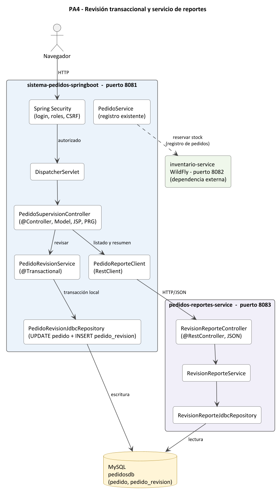

# PA4 — Desarrollo de Aplicaciones Empresariales Avanzado (ISIL, NRC 4622)

Revisión transaccional de pedidos con Spring JDBC, supervisión con Spring MVC y servicio de reportes REST.

| Proyecto | Puerto | Qué cambió en la PA4 |
|---|---|---|
| [`sistema-pedidos-springboot`](sistema-pedidos-springboot/README.md) | 8081 | Revisión transaccional, pantalla de supervisión y cliente HTTP |
| [`pedidos-reportes-service`](pedidos-reportes-service/README.md) | 8083 | Dos recursos REST nuevos de revisión |
| [`inventario-service`](inventario-service/README.md) | 8082 | Sin cambios (dependencia externa para registrar pedidos) |

- **Base de datos:** `database/Script_BD_usuario_MySql.sql` (usuarios) y `database/PA4_cambios_esquema.sql` (esquema).
- **Evidencias:** carpeta `evidencias/`, y los scripts para reproducirlas en `scripts/demo-pa4/`.

Rama evaluada: `feature/pa4-perez`.
