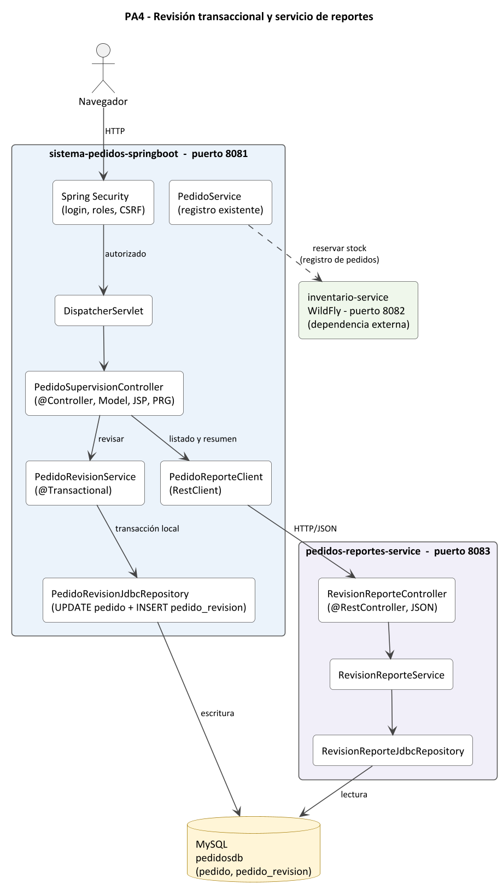

# pedidos-reportes-service (PA4)

Servicio REST de solo lectura sobre la base `pedidosdb`. En la PA4 agregué dos recursos para la revisión de pedidos.



## Requisitos y arranque

- JDK 21, Maven y MySQL 8.x con el usuario `spedidos_reportes`, que solo tiene permiso de lectura (`../database/Script_BD_usuario_MySql.sql`).
- Arrancar **después** de `sistema-pedidos-springboot`, porque ese proyecto crea las tablas.

```bash
mvn spring-boot:run
```

Puerto `8083`, ruta base `/pedidos-reportes-service`. Variables opcionales: `DB_URL`, `DB_USERNAME` y `DB_PASSWORD`.

## Recursos nuevos

| Método | Ruta | Respuesta |
|---|---|---|
| GET | `/api/v1/pedidos/revisiones?estado=PENDIENTE\|REVISADO` | Pedidos con su estado; si está revisado, incluye observación y fecha. Sin `estado` devuelve todos. |
| GET | `/api/v1/pedidos/estadisticas/revisiones` | `totalPedidos`, `totalRevisados`, `totalPendientes` y `porcentajeRevisado` |

Ejemplos:

```json
[{ "pedidoId": 1, "cliente": "Ana Torres", "total": 5000.00, "estado": "REVISADO",
   "observacion": "Datos verificados con el cliente", "fechaRevision": "2026-11-26T20:04:31" }]
```

```json
{ "totalPedidos": 3, "totalRevisados": 1, "totalPendientes": 2, "porcentajeRevisado": 33.33 }
```

**Errores:**
- `400` si `estado` no es PENDIENTE ni REVISADO.
- `503` si la base no responde.

Los dos van en formato `ProblemDetail` (`title`, `detail` y `status`), sin la traza técnica.

**Decisiones de borde:**
- `estado` acepta mayúsculas o minúsculas.
- El porcentaje se redondea a 2 decimales, y es `0.00` cuando no hay pedidos, para no dividir entre cero.

## Pruebas

```bash
mvn test
```

7 pruebas, 0 fallos. Las nuevas son `RevisionReporteControllerIntegrationTest` (contrato REST con H2) y `RevisionReporteServiceImplTest` (cálculos con Mockito). Las pruebas usan H2 y no necesitan MySQL.

## Limitaciones

- No tiene seguridad propia: es un servicio interno al que solo llama `sistema-pedidos` (así viene del proyecto base).
- Las listas no tienen paginación.
